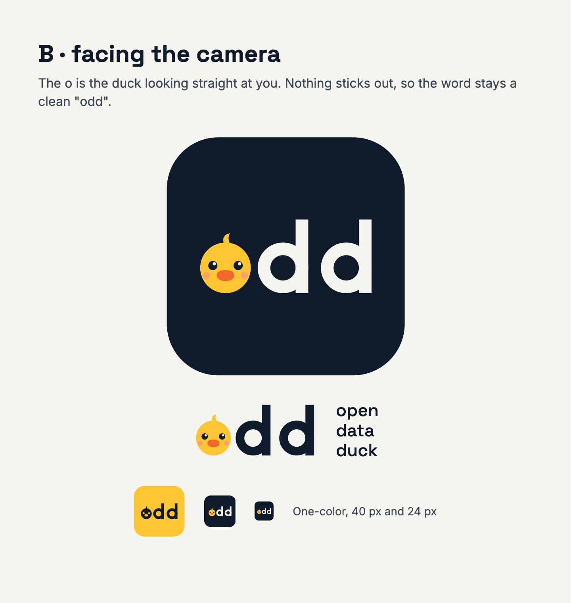

# Open Data Duck brand assets

Primary logo direction from [issue #38](https://github.com/nikmarch/open-data-duck/issues/38): **B · facing the camera**.

Use this PNG for the repository README, docs pages, and early site branding.

## Files

- [`assets/brand/open-data-duck-facing-camera-logo.png`](../assets/brand/open-data-duck-facing-camera-logo.png) — presentation board with app icon, horizontal lockup, and small-size variants.
